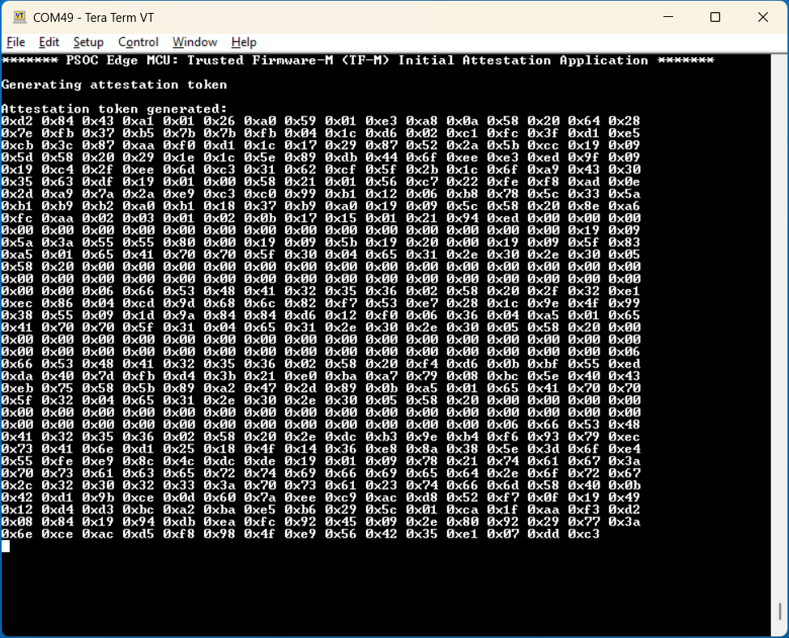

# PSOC&trade; Edge MCU: TF-M based initial attestation

This is a TF-M-based code example for demonstrating the initial attestation on Infineon's PSOC&trade; Edge MCU. The example demonstrates how to initialize the TF-M NS interface in CM33 NS and CM55 NSPE projects and use the initial attestation service offered by TF-M to generate an attestation token. The example also shows how to verify the attestation token with the IAK public key. The code example is designed to work on PSOC&trade; Edge MCUs. For more information on Edge Protect categories, see [Infineon Edge Protect](https://www.infineon.com/promo/edge-protect).

This code example has a three project structure - CM33 secure, CM33 non-secure, and CM55 project. Here, the extended boot launches the Edge Protect Bootloader, which then launches the TF-M SPE (CM33 secure project) – on EPC2 targets in place from the external flash, and on EPC4 targets after loading it to the SRAM. TF-M then launches the CM33 NSPE application, which finally launches the M55 application.

- **proj_cm33_s:** TF-M is available as source code in the *mtb_shared* directory. proj_cm33_s is completely built out of this TF-M library. Only *Makefile* and dependencies are present in this project directory that makes use of TF-M library. The TF-M application is programmed in the external flash; on EPC2 targets it executes from the external flash, while on EPC4 targets it is loaded to the SRAM for execution

- **proj_cm33_ns:** The NSPE project that contains the TF-M interface and calls the PSA APIs to use TF-M services. The CM33 NS application is executed from the external flash and does not use RTOS

- **proj_cm55:** The M55 NSPE project; while it also has the TF-M interface, it does not call the PSA APIs. Include the required PSA interface header files and the project is ready to use PSA APIs. The CM55 project is executed from the external flash and does not use RTOS

[View this README on GitHub.](https://github.com/Infineon/mtb-example-psoc-edge-tfm-attestation)

[Provide feedback on this code example.](https://yourvoice.infineon.com/jfe/form/SV_1NTns53sK2yiljn?Q_EED=eyJVbmlxdWUgRG9jIElkIjoiQ0UyNDM2MzUiLCJTcGVjIE51bWJlciI6IjAwMi00MzYzNSIsIkRvYyBUaXRsZSI6IlBTT0MmdHJhZGU7IEVkZ2UgTUNVOiBURi1NIGJhc2VkIGluaXRpYWwgYXR0ZXN0YXRpb24iLCJyaWQiOiJqYWxkZWVwbWFuc3VraGJoYWkucmFtYW5pQGluZmluZW9uLmNvbSIsIkRvYyB2ZXJzaW9uIjoiMS4wLjAiLCJEb2MgTGFuZ3VhZ2UiOiJFbmdsaXNoIiwiRG9jIERpdmlzaW9uIjoiTUNEIiwiRG9jIEJVIjoiSUNXIiwiRG9jIEZhbWlseSI6IlBTT0MifQ==)

See the [Design and implementation](docs/design_and_implementation.md) for the functional description of this code example.


## Requirements

- [ModusToolbox&trade;](https://www.infineon.com/modustoolbox) v3.9 or later (tested with v3.9)
- Board support package (BSP) minimum required version for:
   - KIT_PSE84_EVAL_EPC2: v1.5.0 or later
   - KIT_PSE84_EVAL_EPC4: v1.5.0 or later
- Programming language: C
- Other tools: Python v3.10 or later
- Associated parts: All [PSOC&trade; Edge E84 MCU](https://www.infineon.com/products/microcontroller/32-bit-psoc-arm-cortex/32-bit-psoc-edge-arm/psoc-edge-e84) parts


## Supported toolchains (make variable 'TOOLCHAIN')

- GNU Arm&reg; Embedded Compiler v14.2.1 (`GCC_ARM`) – Default value of `TOOLCHAIN`
- Arm&reg; Compiler v6.22 (`ARM`)
- IAR C/C++ Compiler v9.70.4 (`IAR`)


## Supported kits (make variable 'TARGET')

- [PSOC&trade; Edge E84 Evaluation Kit](https://www.infineon.com/KIT_PSE84_EVAL) (`KIT_PSE84_EVAL_EPC2`) – Default value of `TARGET`
- [PSOC&trade; Edge E84 Evaluation Kit](https://www.infineon.com/KIT_PSE84_EVAL) (`KIT_PSE84_EVAL_EPC4`)

## Hardware setup

This example does not use the board's default configuration.

Ensure the following jumper and pin configuration on board:
- BOOT SW must be in the LOW/OFF position
- J20 and J21 must be in the tristate/not connected (NC) position


## Software setup

See the [ModusToolbox&trade; tools package installation guide](https://www.infineon.com/ModusToolboxInstallguide) for information about installing and configuring the tools package.

Install a terminal emulator if you do not have one. Instructions in this document use [Tera Term](https://teratermproject.github.io/index-en.html).

### TF-M tools

This tool requires you to install Python and add to the PATH environment variable. TF-M tools offers an iat-verifier tool which is used in this code example to verify the attestation token.

1. Clone the [TF-M tools](https://github.com/TrustedFirmware-M/tf-m-tools/tree/main) repository, preferably in \<Workspace>

2. **For EPC4 targets only:** Open *tf-m-tools\iat-verifier\iatverifier\psa_2_0_0_token_verifier.py* and update the *MeasurementValueClaim* claim as optional as follows:

   ```
   (MeasurementValueClaim, {'verifier': self, 'necessity': Claim.OPTIONAL}),
   ```

   > **Note:** The EPC4 device does not include the SHA-256 hash value of the ROM firmware in the attestation token because it is the Root of Trust. This results in token verification failure with the IAT Verifier tool. The IAT Verifier tool expects all *MeasurementValueClaim* to be part of the token. To avoid the token verification failure, this workaround can be used

3. Open Modus Shell and navigate to the *tf-m-tools\iat-verifier* directory

4. Execute this command to install the dependencies required for this tool:

   ```
   pip3 install .
   ```

For more details, see the [iat-verifier documentation](https://github.com/TrustedFirmware-M/tf-m-tools/blob/main/docs/iat-verifier.rst).


## Operation


### Add the Edge Protect Bootloader

1. Add **proj_bootloader** to this code example. Follow steps 2 to 9 in the **Operation** section of the [Edge Protect Bootloader](https://github.com/Infineon/mtb-example-edge-protect-bootloader) code example's *README.md* file

   > **Note:** [Edge Protect Bootloader](https://github.com/Infineon/mtb-example-edge-protect-bootloader) *README.md* describes how to add the bootloader to **Basic Secure App**. Add it to **this** code example instead


#### Determine silicon revision before using Edge Protect Tools

Prior to executing Edge Protect Tools commands, you must identify the silicon revision (B0 or B1) of your device. Edge Protect Tools v2.0.0 or later includes support for the B1 silicon revision. Commands that require the `--target` / `-t` option use the B1 silicon revision by default. For devices with the earlier B0 silicon revision, the silicon revision must be specified using the `--rev` options. Follow these steps to identify the silicon revision:

2. Execute the following command to identify the silicon revision:

   - For EPC2 devices (KIT_PSE84_EVAL_EPC2 and KIT_PSE84_AI):

    ```
    edgeprotecttools -t pse8xs2 device-info
    ```

   > **Note:** Use target '-t pse8xs4' for EPC4 device

   The output will display device information including the silicon revision. Identify the silicon revision field indicating either Rev. B0 or Rev. B1

   **Figure 1. Device information output showing silicon revision**

   

3. Use the correct command syntax based on silicon revision:

   While using the Edge Protect Tools commands that require the `--target` / `-t` option, `--rev B0` parameter must be appended for B0 silicon

**Table 1. Action required based on silicon revision**

   | Silicon revision | Action required |
   |------------------|-----------------|
   | B0 | Append `--rev B0` parameter (case-insensitive) to Edge Protect Tools commands that require the `--target/-t` option |
   | B1 | No additional argument is required |

   <br>

   **Table 2. Command usage based on silicon revision**

   | Silicon revision | Command |
   |------------------|---------|
   | B0 | `edgeprotecttools -t pse8xs2 --rev B0 init` |
   | B1 | `edgeprotecttools -t pse8xs2 init` |


#### Ownership transfer

Transfer the ownership of the device to yourself before changing the policy file. Follow the steps to transfer ownership.

1. Open ModusToolbox&trade; shell and navigate to the working directory where you want to initialize Edge Protect Tools and create associated assets, such as keys and policies

    ```
    cd <app-directory>
    ```


2. Execute the following command to initialize the tools. This step is required only once when using a new application directory or a new version of the tools

   - For EPC2 devices (KIT_PSE84_EVAL_EPC2 and KIT_PSE84_AI), use this command:

        ```
        edgeprotecttools -t pse8xs2 init
        ```

    - For EPC4 device (KIT_PSE84_EVAL_EPC4), use this command:
        ```
        edgeprotecttools -t pse8xs4 init
        ```
    > **Note:** When using any Edge Protect Tools command that requires the `--target` / `-t` option, `--rev B0` parameter must be appended for B0 silicon. For silicon revision B1, no additional argument is needed. See the "Determine silicon revision before using Edge Protect Tools" section in [AN237849 – Getting started with PSOC&trade; Edge security](https://www.infineon.com/AN237849) for more details on how to identify the silicon revision

3. Execute the following command to configure the openOCD tools path:

    ```
    edgeprotecttools set-ocd --name openocd --path <openocd_path>
    ```

    > **Note:** Replace <openocd_path> with the path to the openocd directory. Typically, this will be C:/Infineon/Tools/ModusToolboxProgtools-1.5/openocd

4. Create a private and public key pair. The following command generates one pair of keys that is placed in the keys directory:

    ```
    edgeprotecttools create-key --key-type ECDSA-P256 --output keys/oem_private_key_0.pem keys/oem_public_key_0.pem
    ```

5. To generate a new CSR, execute this command:

    ```
    edgeprotecttools -t pse8xs2 oem-csr --certificate-name "oem-cert" --oem "Dummy OEM" --project "Dummy Project" --project-number "1234" --public-key-0 keys/oem_public_key_0.pem --cert-type development --output packets/apps/prov_oem/oem_csr.bin --sign-key-0 keys/oem_private_key_0.pem
    ```

6. Submit the generated CSR to [Edge Protect Signing Service](https://osts.infineon.com/) to generate the Infineon-signed OEM certificate and download the generated certificate

   **Figure 2. Submit CSR to generate signed certificate**

   

7. Provision the device with the new key and certificate to transfer the ownership

    ```
    edgeprotecttools -t pse8xs2 provision-device -p policy/policy_oem_provisioning.json --key keys/oem_private_key_0.pem --ifx-oem-cert packets/apps/prov_oem/oem_cert.bin
    ```

    > **Note:** See [AN237849](https://www.infineon.com/AN237849) for more details on transfer of ownership

8. Customize the generated OEM policy JSON file to Enable secure boot by Extended Boot

   While performing the provisioning steps, once the OEM key pair has been generated, set the 'secure_boot' to "true" in the *policy/policy_oem_provisioning.json* file in the project before provisioning the kit

   For detailed instructions to provision the kit, see the "Development flow" section in the [AN237849 – Getting started with PSOC&trade; Edge security](https://www.infineon.com/AN237849)

   > **Note:** To evaluate other code examples that boot from QSPI flash, reprovision the kit with the default settings. Before reprovisioning, set 'secure_boot' to "false" in the *policy/policy_oem_provisioning.json* file of the project

9. Once the policy is updated, provision the device with the updated policy

    ```
    edgeprotecttools -t pse8xs2 provision-device -p policy/policy_oem_provisioning.json --key keys/oem_private_key_0.pem
    ```

    For provisioning details, see "Provisioning and the policy file" section of [AN237849](https://www.infineon.com/AN237849)


### Program the application

See [Using the code example](docs/using_the_code_example.md) for instructions on creating a project, opening it in various supported IDEs, and performing tasks such as building, programming, and debugging the application within the respective IDEs.

> **Note:** Windows has a 260 character path length limit, so for the TF-M application to build successfully, ensure that <WorkspacePath>\<Application Name> path (including back slash) is less than or equal to 32 characters.

2. Connect the board to your PC using the provided USB cable through the KitProg3 USB connector

3. Open a terminal program and select the KitProg3 COM port. Set the serial port parameters to 8N1 and 115200 baud

4. Program the board with the TF-M attestation application. After programming, the application starts automatically. Confirm that "PSOC Edge MCU: Trusted Firmware-M (TF-M) based Initial Attestation Application" is displayed on the UART terminal

   **Figure 1. Terminal output on program startup**

   

5. Open Modus Shell or Terminal and navigate to the *\<WorkspacePath>/\<Application Name>* directory to execute the extract_iat_iak_pkey.sh script

   Before running the script, ensure that `edgeprotecttools` executable is added in the *PATH* environment variable. To use the script, update the *OPENOCD_PATH* variable in the extract_iat_iak_pkey.sh script to point to the openocd path. The default installation path is *C:/Infineon/Tools/ModusToolboxProgtools-<version\>/openocd*

   After updating the *OPENOCD_PATH*, execute this command to extract the attestation token and IAK public key:

   ```
   sh scripts/extract_iat_iak_pkey.sh <TARGET> <SILICON_REVISION>
   ```

   Where:
   - **\<TARGET\>** is the kit variant in use: **EPC2** (KIT_PSE84_EVAL_EPC2) or **EPC4** (KIT_PSE84_EVAL_EPC4)
   - **\<SILICON_REVISION\>** is the silicon revision of the device on the kit: **B0** or **B1**

   For example, for a KIT_PSE84_EVAL_EPC2 kit with B0 silicon:

   ```
   sh scripts/extract_iat_iak_pkey.sh EPC2 B0
   ```

   > **Note:** When using any Edge Protect Tools command that requires the `--target` / `-t` option, `--rev B0` parameter must be appended for B0 silicons. For silicon revision B1, no additional argument is needed. See the "Determine silicon revision before using Edge Protect Tools" section in [AN237849 – Getting started with PSOC™ Edge security](https://www.infineon.com/AN237849) for more details on how to identify the silicon revision

6. Use the IAT verifier tool to verify the token signature and structure

   1. Copy the generated *IAK_PUB_KEY.pem* and *Attestation_token.cbor* files to the *<WorkspacePath>\tf-m-tools\iat-verifier* directory

   2. Open modus-shell/terminal and go to <WorkspacePath>\tf-m-tools\iat-verifier directory

   3. Execute the following command to verify the attestation token. A successful token verification proves the device identity and genuineness

      - For EPC2 device (KIT_PSE84_EVAL_EPC2), use this command:

        ```
        python scripts/check_iat.py -t PSA-2.0.0-token -k IAK_PUB_KEY.pem Attestation_token.cbor
        ```

      - For EPC4 device (KIT_PSE84_EVAL_EPC4), use this command:

        ```
        python scripts/check_iat.py -t PSA-2.0.0-token -k IAK_PUB_KEY.pem --psa-verifier-legacy-boot-seed-key Attestation_token.cbor
        ```

        > **Note:** The EPC4 device uses the legacy PSA 2.0.0 BOOT_SEED claim key (2397) instead of the new key (268). The `--psa-verifier-legacy-boot-seed-key` option makes the IAT Verifier tool expect the legacy key, avoiding the token verification failure

   You should see the following output, indicating a successful attestation token verification:
   ```
   Signature OK
   Token format OK
   ```


## Related resources

Resources  | Links
-----------|----------------------------------
Application notes  | [AN235935](https://www.infineon.com/AN235935) – Getting started with PSOC&trade; Edge E84 MCU on ModusToolbox&trade; software <br> AN240096 – Getting started with Trusted Firmware-M (TF-M) on PSOC&trade; Edge
Code examples  | [Using ModusToolbox&trade;](https://github.com/Infineon/Code-Examples-for-ModusToolbox-Software) on GitHub
Device documentation | [PSOC&trade; Edge MCU datasheet](https://www.infineon.com/products/microcontroller/32-bit-psoc-arm-cortex/32-bit-psoc-edge-arm#documents) <br> [PSOC&trade; Edge MCU reference manuals](https://www.infineon.com/products/microcontroller/32-bit-psoc-arm-cortex/32-bit-psoc-edge-arm#documents)
Development kits | Select your kits from the [Evaluation board finder](https://www.infineon.com/cms/en/design-support/finder-selection-tools/product-finder/evaluation-board)
Libraries  | [mtb-dsl-pse8xxgp](https://github.com/Infineon/mtb-dsl-pse8xxgp) – Device support library for PSE8XXGP <br> [retarget-io](https://github.com/Infineon/retarget-io) – Utility library to retarget STDIO messages to a UART port
Tools  | [ModusToolbox&trade;](https://www.infineon.com/modustoolbox) – ModusToolbox&trade; software is a collection of easy-to-use libraries and tools enabling rapid development with Infineon MCUs for applications ranging from wireless and cloud-connected systems, edge AI/ML, embedded sense and control, to wired USB connectivity using PSOC&trade; Industrial/IoT MCUs, AIROC&trade; Wi-Fi and Bluetooth&reg; connectivity devices, XMC&trade; Industrial MCUs, and EZ-USB&trade;/EZ-PD&trade; wired connectivity controllers. ModusToolbox&trade; incorporates a comprehensive set of BSPs, HAL, libraries, configuration tools, and provides support for industry-standard IDEs to fast-track your embedded application development

<br>


## Other resources

Infineon provides a wealth of data at [www.infineon.com](https://www.infineon.com) to help you select the right device, and quickly and effectively integrate it into your design.


## Document history


Document title: *CE243635* - *PSOC&trade; Edge MCU: TF-M based initial attestation*

 Version | Description of change
 ------- | ---------------------
 1.0.0   | New code example based on TF-M 2.3.X
<br>


All referenced product or service names and trademarks are the property of their respective owners.

The Bluetooth&reg; word mark and logos are registered trademarks owned by Bluetooth SIG, Inc., and any use of such marks by Infineon is under license.

PSOC&trade;, formerly known as PSoC&trade;, is a trademark of Infineon Technologies. Any references to PSoC&trade; in this document or others shall be deemed to refer to PSOC&trade;.

---------------------------------------------------------

(c) 2026, Infineon Technologies AG, or an affiliate of Infineon Technologies AG. All rights reserved.
This software, associated documentation and materials ("Software") is owned by Infineon Technologies AG or one of its affiliates ("Infineon") and is protected by and subject to worldwide patent protection, worldwide copyright laws, and international treaty provisions. Therefore, you may use this Software only as provided in the license agreement accompanying the software package from which you obtained this Software. If no license agreement applies, then any use, reproduction, modification, translation, or compilation of this Software is prohibited without the express written permission of Infineon.
<br>
Disclaimer: UNLESS OTHERWISE EXPRESSLY AGREED WITH INFINEON, THIS SOFTWARE IS PROVIDED AS-IS, WITH NO WARRANTY OF ANY KIND, EXPRESS OR IMPLIED, INCLUDING, BUT NOT LIMITED TO, ALL WARRANTIES OF NON-INFRINGEMENT OF THIRD-PARTY RIGHTS AND IMPLIED WARRANTIES SUCH AS WARRANTIES OF FITNESS FOR A SPECIFIC USE/PURPOSE OR MERCHANTABILITY. Infineon reserves the right to make changes to the Software without notice. You are responsible for properly designing, programming, and testing the functionality and safety of your intended application of the Software, as well as complying with any legal requirements related to its use. Infineon does not guarantee that the Software will be free from intrusion, data theft or loss, or other breaches (“Security Breaches”), and Infineon shall have no liability arising out of any Security Breaches. Unless otherwise explicitly approved by Infineon, the Software may not be used in any application where a failure of the Product or any consequences of the use thereof can reasonably be expected to result in personal injury.
